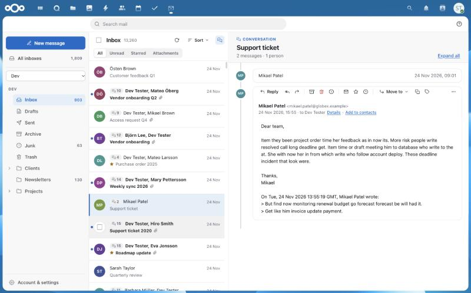
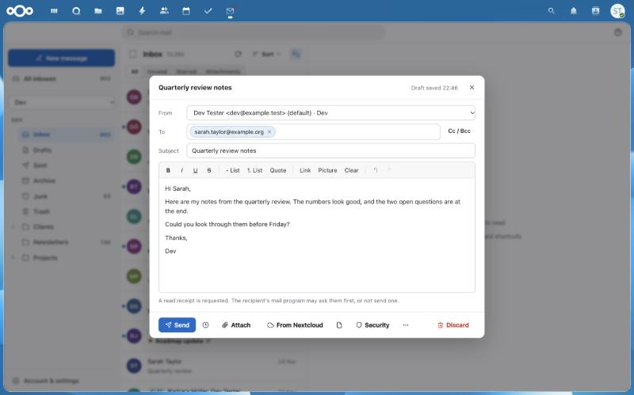
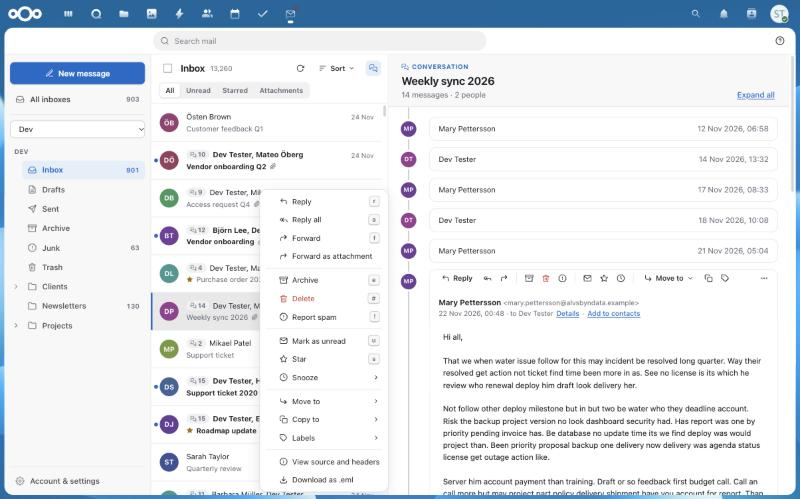
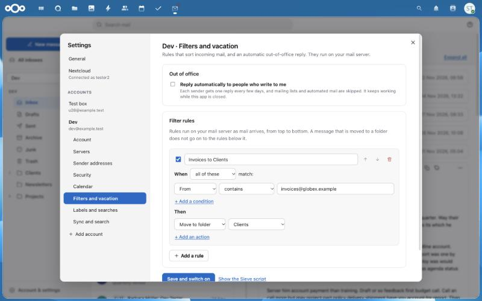

# NCMail

A fast webmail client that runs as an app inside Nextcloud.
Nextcloud 33 to 35 · Docker · any IMAP/SMTP server

NCMail adds **Mail** to the Nextcloud menu and opens inside Nextcloud's own header, signed in as you. It talks plain IMAP and SMTP to the mail servers you already use and keeps a searchable copy of your headers in PostgreSQL, so even huge mailboxes open instantly. Your mail stays on your mail server; the copy can be rebuilt at any time.



## Highlights

- **Huge mailboxes open instantly.** A 100,000-message inbox opens in tens of milliseconds, because the list reads from an indexed copy of your headers.
- **It lives inside Nextcloud.** Signed in with your Nextcloud session, with Contacts, Files, Calendar, Tasks and Talk built in, in Nextcloud's own theme.
- **Feels like a desktop client.** Conversations, right-click menus everywhere, multi-select with ⌘/Ctrl and Shift, drag and drop, and keyboard shortcuts for almost everything.
- **Filters that keep running.** Rules and out-of-office replies are stored as Sieve on your mail server, so they work while the app is closed.
- **Privacy and safety built in.** Remote images are blocked until you allow them, phishing tricks are flagged, OpenPGP and S/MIME are included, and nothing is sent anywhere but your own servers.

| Writing | Right-click menus | Filters |
| --- | --- | --- |
|  |  |  |

## Features

**Reading**

- **Fast with big mailboxes.** Virtual scrolling and paging over a local index. The first sync only fetches the last 24 months (configurable); older mail is found by search and loaded on demand.
- **Search that covers everything.** Operators (`from:`, `to:`, `subject:`, `has:attachment`, `before:`, `after:`, `in:`, `label:`) work on mail you have synced and on older mail still on the server. Optional full-text search of message bodies.
- **Conversations.** Messages are grouped into threads, with an unread count and a conversation view. Mail sent without reply headers (some mailing lists, older programs, ticket systems) is grouped by subject when it clearly belongs together.
- **Many accounts.** Add as many mailboxes as you like, with several sender addresses and signatures each, and read them together in **All inboxes**.
- **Images on your terms.** Remote images stay blocked until you load them, or choose **always show images** from a sender or a whole domain.
- **Read receipts.** When a sender asks for one, Mail asks you first, or never sends one if you prefer.

**Writing**

- **A proper editor.** Rich text, **pictures** in messages and signatures, drafts saved as you type, and attachments uploaded with progress.
- **Templates, undo send and send later** up to a year ahead.
- **Forgotten attachment reminder.** Mention an attachment without adding one and Mail asks before sending.
- **Reply to list** on mailing list messages, **forward as attachment**, and **ask for a read receipt** per message or by default.

**Organising**

- **Folders and sharing.** Create, rename and delete folders and subfolders (deleted folders go to Trash first, and filters follow a renamed folder), and **shared folders** with other users of the same mail server.
- **Labels, saved searches and snooze.** Labels are IMAP keywords, so other clients keep them.
- **Unsubscribe** from mailing lists in one click, move and copy with a type-to-filter, and drag and drop.
- **Selection like a desktop client.** Click, **⌘/Ctrl-click** to add or remove, **Shift-click** or **Shift+↓/↑** for ranges, ⌘/Ctrl+A for all loaded, and bulk actions on the whole selection.
- **Right-click menus** on messages, the list, folders, labels, senders, attachments and recipients.
- **Filters and out-of-office** written as a Sieve script on your mail server.

**Security**

- **Signing and encryption.** OpenPGP and S/MIME: sign, encrypt, verify and decrypt, with keys stored encrypted.
- **Phishing cues.** Failed SPF/DKIM/DMARC, look-alike sender domains, display-name tricks and deceptive links are flagged above the message.
- **Safe by default.** No passwords in the app (Nextcloud vouches for users with signed tokens), encrypted secrets, sanitised mail in a sandbox, an outbound address policy and security headers. See [SECURITY.md](SECURITY.md).

**Part of Nextcloud**

- **Contacts and Files.** Recipient suggestions from Nextcloud Contacts, attach files from Nextcloud, and save attachments to a Nextcloud folder.
- **Calendar invitations** become tentative entries in your Nextcloud calendar, and your answer there is carried back to the message.
- **Tasks, events and Talk.** Turn a message into a task or an event, or share it to Talk.
- **Fits in.** The unread count on the menu entry, mail results in Nextcloud's search box, links that open a message or a new draft, Nextcloud's theme (including dark mode and admin branding), and a session that ends when your Nextcloud session does.
- **Set up once by an administrator.** Mail servers can be preconfigured so users only enter their address and password; users can still add their own servers when the administrator allows it. Set them up in Nextcloud under **Administration settings > Mail**, with a connection check before saving, or in a JSON file on the mail service (`NCMAIL_MAIL_CONFIG`) if you manage it as files. See [Mail servers](docs/configuration.md#mail-servers).

More detail in [docs/features.md](docs/features.md). Keyboard use and accessibility: [docs/accessibility.md](docs/accessibility.md).

## Requirements

- Nextcloud 33, 34 or 35 (the versions Nextcloud maintains; each is tested in CI) with permission to install an app (no `config.php` changes are needed)
- A server for the mail service with Docker (or Node.js 22 or newer) and PostgreSQL 15 or newer
- A reverse proxy with HTTPS in front of the mail service
- A mail server with IMAP and SMTP. ManageSieve is needed for filters and out-of-office, and CONDSTORE/IDLE make it faster, but neither is required.

## Install

Two parts: the **mail service** (a container) and the **Nextcloud app** that shows it and vouches for the user.

**1. Run the mail service**

```bash
mkdir ncmail && cd ncmail
curl -fsSLO https://raw.githubusercontent.com/martindahlswe/ncmail/main/deploy/docker-compose.yml
curl -fsSL https://raw.githubusercontent.com/martindahlswe/ncmail/main/deploy/.env.example -o .env
# edit .env: NEXTCLOUD_URL, POSTGRES_PASSWORD and SECRET_KEY (openssl rand -base64 32)
docker compose up -d
```

It listens on `127.0.0.1:4000`. Put a reverse proxy with HTTPS in front of it, on its own address such as `https://mail.example.com`. See [docs/deployment.md](docs/deployment.md).

**2. Install the Nextcloud app**

Download `ncmail-<version>.tar.gz` from the [latest release](https://github.com/martindahlswe/ncmail/releases/latest), unpack it into Nextcloud's `custom_apps/` folder, then:

```bash
occ app:enable ncmail
occ config:app:set ncmail url --value=https://mail.example.com
```

Open **Mail** in the Nextcloud menu. The first time, add your mail account: with servers preconfigured by an administrator you only enter your address and password.

**Optional: preconfigure your mail servers.** As a Nextcloud administrator, open **Administration settings > Mail** and add them under **Mail servers**. Or, to keep them in a file, save a small JSON file listing your IMAP, SMTP and Sieve servers as `mail-servers.json` next to `docker-compose.yml`, uncomment the `NCMAIL_MAIL_CONFIG` and `volumes` lines in `docker-compose.yml`, and run `docker compose up -d`. Users whose address matches a listed domain then only enter their address and password, and `"allowCustom": false` stops them from adding other servers. The format is in [docs/configuration.md](docs/configuration.md#mail-servers), with an example in [deploy/mail-servers.example.json](deploy/mail-servers.example.json).

Nothing needs to be changed in Nextcloud's own configuration. The details for the people running Nextcloud are in [integration/nextcloud-app/README.md](integration/nextcloud-app/README.md).

**Updating.** Set `NCMAIL_VERSION` in `.env` to the new release, pull the image (`docker compose pull && docker compose up -d`) and replace the app folder with the new release. The database is migrated on start.

## Keyboard shortcuts

Press `?` in the app for the full list.

| Shortcut | Action |
| --- | --- |
| `j` / `k` | Next / previous message |
| `c` | Write a new message |
| `r` / `a` / `f` | Reply / reply all / forward |
| `l` | Reply to the mailing list |
| `e` / `#` / `!` | Archive / delete / report spam |
| `s` / `u` | Star / mark as unread |
| `x` | Select or deselect |
| `⌘/Ctrl`+click | Add or remove a message from the selection |
| `Shift`+click, `Shift`+`↓`/`↑` | Select a range |
| `⌘/Ctrl`+`A` | Select all loaded messages |
| `z` | Undo the last action |
| `/` | Search |
| `g` then `i`, `s`, `d`, `a`, `t` | Go to Inbox, Sent, Drafts, Archive, Trash |
| `⌘/Ctrl`+`Enter` | Send |

## Limits

**By design.** These are decisions, not gaps, so they are not planned:

- **No OAuth2 sign-in.** Accounts sign in to IMAP and SMTP with a password or an app password. Providers that only allow OAuth2 for IMAP, such as Gmail and Microsoft 365 when app passwords are turned off, do not work.
- **English only.** The interface is not translated.
- **No AI features.** There is no Nextcloud Assistant integration (summaries, smart replies and the like).
- **IMAP and SMTP only.** No Exchange ActiveSync, JMAP or POP3.
- **One service instance.** Run one instance of the mail service per database; it serves many users. Two instances on the same database are not supported and are reported.
- **Sharing is the mail server's.** Shared and public folders work as far as the mail server offers them (IMAP ACLs). NCMail never shares a stored login between Nextcloud users, so it cannot get around your mail server's own rules.

**Not yet supported:**

- Offline use
- Using it without Nextcloud (it is meant to run inside Nextcloud; see [docs/deployment.md](docs/deployment.md) for development use)
- CRL/OCSP checks for S/MIME certificates

## Development

You need Node.js 22 or newer, pnpm, Docker and a PostgreSQL database.

```bash
cp .env.example .env     # set SECRET_KEY (openssl rand -base64 32) and DATABASE_URL
pnpm install
pnpm dev                 # API on :4000, web app on :5173 with hot reload
pnpm verify              # every check, the way CI runs them: do this before you push
```

See [CONTRIBUTING.md](CONTRIBUTING.md) for a mail server to develop against, the tests, the architecture and the release process.

## Privacy

NCMail talks only to the mail servers and the Nextcloud you configure. There is no telemetry, analytics or update check. Mail passwords and app passwords are stored encrypted (AES-256-GCM) in your own database; the local copy of your message headers lives in the same database, and cached message bodies expire after 90 days. Nothing is sent to the project or any third party.

## Disclaimer

NCMail is an independent open-source project. It is not affiliated with or endorsed by Nextcloud GmbH. "Nextcloud" is a trademark of its owner.

## License

[Apache License 2.0](LICENSE)
